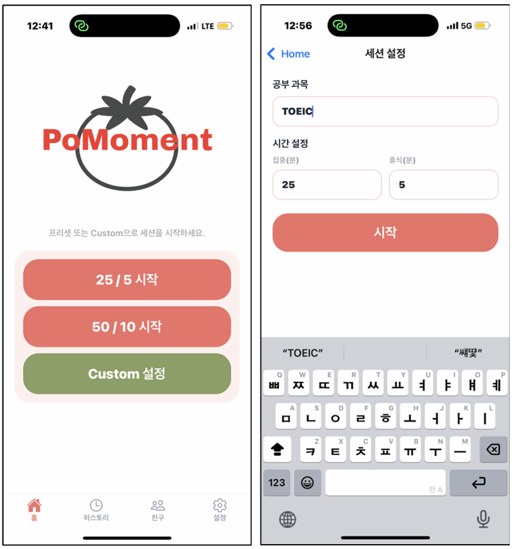
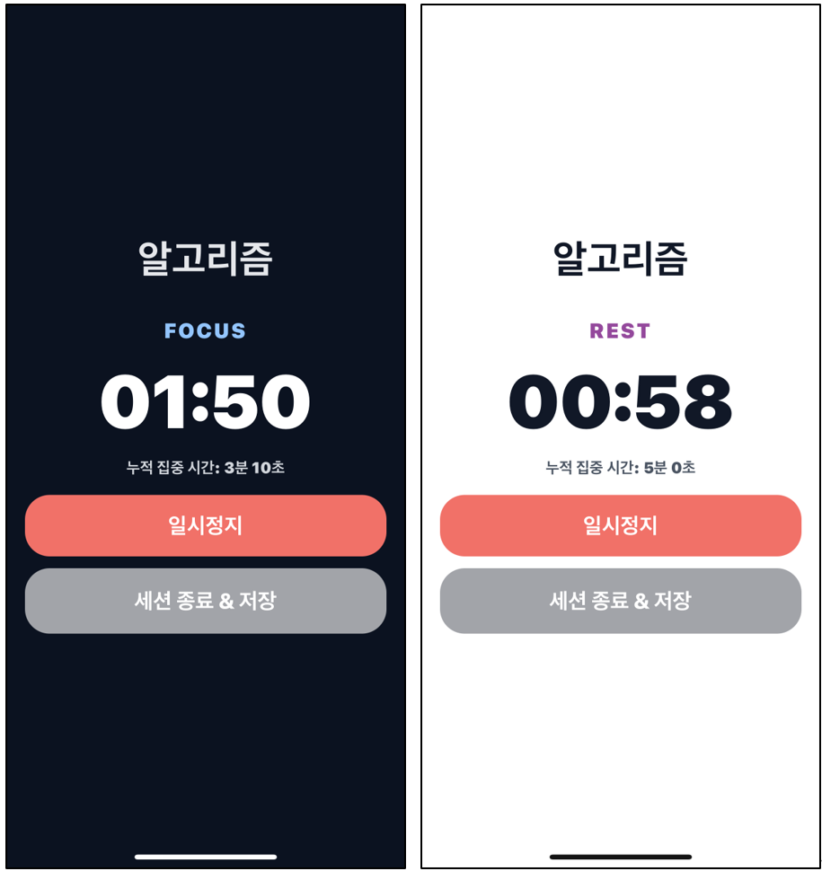
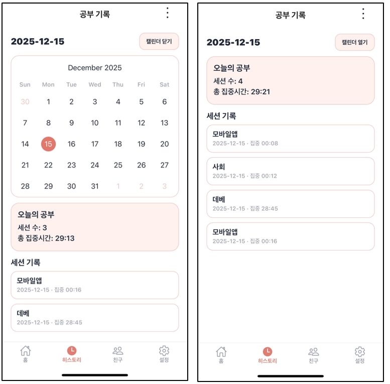
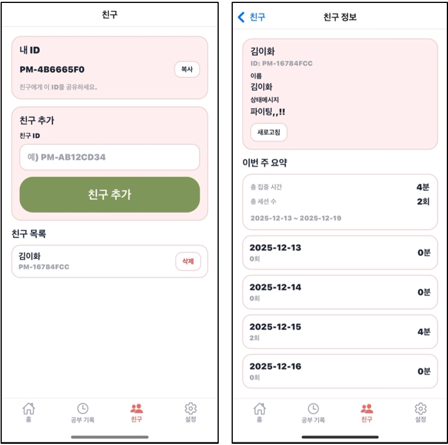

# PoMoment ⏱️

**JavaScript · React Native · Expo · Firebase · AsyncStorage**  
**개인 프로젝트 | 모바일 앱 기획·개발·테스트**

PoMoment는 **포모도로(Pomodoro) 기법을 활용한 학습 기록 및 공유 앱**입니다. 사용자가 집중·휴식 시간을 설정해 공부하고, 세션별 기록을 확인하며, 친구의 주간 학습 현황도 살펴볼 수 있도록 구현했습니다.

## 📱 주요 기능 및 실행 화면

### 1. 홈 / 학습 세션 설정
25분 집중·5분 휴식, 50분 집중·10분 휴식 프리셋과 사용자 지정 시간을 제공합니다. 공부할 과목과 집중·휴식 시간을 설정한 뒤 세션을 시작할 수 있습니다.



### 2. 집중 / 휴식 타이머
집중(FOCUS)과 휴식(REST) 모드를 전환하며, 진행 중인 타이머를 일시정지하거나 재개할 수 있습니다. 세션 종료 시 학습 기록을 저장합니다.



### 3. 학습 기록 조회
AsyncStorage에 학습 세션을 저장하고 날짜별·세션별로 공부한 과목과 집중·휴식 시간을 조회하도록 구현했습니다.



### 4. 친구 / 학습 현황 공유
친구 ID를 통한 추가와 프로필·주간 학습 현황 조회를 위한 화면 및 Firestore 연동 코드를 구현했습니다.



## 🛠 기술 스택

| 영역 | 사용 기술 | 구현 내용 |
|---|---|---|
| 언어·모바일 | JavaScript, React Native, Expo | 화면과 사용자 인터랙션 구현 |
| 화면 전환 | React Navigation (Native Stack, Bottom Tabs) | 홈·히스토리·친구·설정 탭 및 타이머 화면 전환 |
| 로컬 저장 | AsyncStorage | 학습 세션 및 앱 설정 저장·조회 |
| 클라우드 | Firebase Authentication (Anonymous), Firestore | 사용자 식별 및 친구·학습 기록 관리 관련 로직 |
| 기타 | React Native Calendars, Expo Haptics, Expo AV | 달력형 기록 UI, 진동 및 알림음 |

> 별도 백엔드 REST API 서버를 개발한 프로젝트가 아니라, React Native 앱에서 로컬 저장소와 Firebase SDK를 활용한 프로젝트입니다.

## 🔄 데이터 흐름

1. **Create:** 과목과 집중·휴식 시간을 설정하고 학습 세션을 진행합니다.
2. **Save:** 세션 종료 시 기록을 생성해 AsyncStorage에 저장하며, Firestore를 활용한 클라우드 저장 로직을 구성했습니다.
3. **Share:** Firebase 사용자 식별 정보와 Firestore를 활용해 친구의 학습 기록을 조회하도록 설계했습니다.

코드는 화면, 데이터 저장, Firebase 연동 등 역할별로 분리했습니다.

```text
App.js                 # 앱 내비게이션 구성
src/
├── screens/            # Home / Setup / Timer / History / Friends / Settings
├── components/         # 공통 UI 컴포넌트
├── storage/            # 학습 기록 및 사용자 관련 데이터 처리
├── firebase/           # Firebase 설정·인증 관련 로직
├── theme/              # 공통 색상·타이포그래피
└── utils/              # 시간 관련 공통 함수
assets/                 # 이미지·알림음
```

## 💡 문제 해결: 화면 전환 시 Safe Area가 어긋나는 현상

**문제**  
타이머를 종료하고 다른 화면으로 이동할 때, 노치 또는 Dynamic Island가 있는 기기에서 상단 헤더가 상태바에 가려지는 현상이 발생했습니다.

**원인 분석 및 조치**  
기존 탭 내부에 있던 타이머 화면을 `TabNavigator`에서 분리하고, `RootStack`에 배치하도록 내비게이션 계층을 수정했습니다. 앱 최상단에는 `SafeAreaProvider`를 적용했습니다.

**결과**  
화면을 전환한 후에도 상단 헤더와 레이아웃이 안정적으로 표시되도록 개선했습니다.

> 관련 코드: [`App.js`](App.js) — `RootStack.Navigator`, `Tabs`, `Timer` 구성

## ▶ 실행 방법

Node.js/npm과 iOS·Android의 Expo Go가 필요합니다.

```bash
npm install
npx expo start -c
```

개발 기기와 휴대폰이 같은 네트워크에 연결되어 있어야 합니다. 로컬 연결이 어려우면 아래 방식도 시도할 수 있습니다.

```bash
npx expo start -c --tunnel
```

> Firebase 관련 기능은 프로젝트의 인증·Firestore 설정 및 보안 규칙이 필요할 수 있습니다. 본 저장소를 그대로 실행할 때에는 해당 환경 구성이 맞는지 확인해야 합니다.

## 🙋 담당 범위

개인 프로젝트로 **기획, UI 구현, 타이머 및 기록 기능 개발, 로컬·클라우드 데이터 연동 코드 작성, 테스트**를 수행했습니다.
